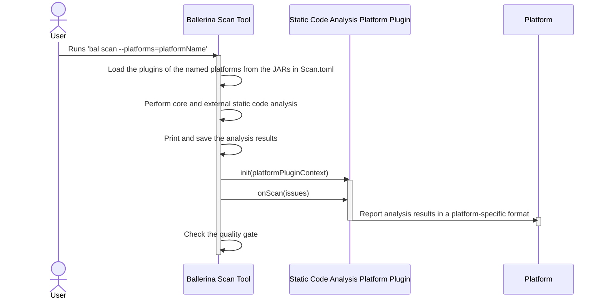

# Static Code Analysis Platform Plugin

# Contents

- [What is a Static Code Analysis Platform Plugin?](#what-is-a-static-code-analysis-platform-plugin)
- [Components of the Static Code Analysis Platform Plugin](#components-of-the-static-code-analysis-platform-plugin)
  - [`StaticCodeAnalysisPlatformPlugin` interface](#staticcodeanalysisplatformplugin-interface)
  - [`PlatformPluginContext` interface](#platformplugincontext-interface)
  - [Platform arguments](#platform-arguments)
- [Steps to create a Static Code Analysis Platform Plugin](#steps-to-create-a-static-code-analysis-platform-plugin)
  - [Step 1: Add the static code analysis tool dependencies to the project](#step-1-add-the-static-code-analysis-tool-dependencies-to-the-project)
  - [Step 2: Defining the service provider interface file](#step-2-defining-the-service-provider-interface-file)
  - [Step 3: Implement the platform plugin](#step-3-implement-the-platform-plugin)
  - [Step 4: Report to the platform](#step-4-report-to-the-platform)
- [References](#references)

# What is a Static Code Analysis Platform Plugin?



A Static Code Analysis Platform Plugin is an implementation of the `StaticCodeAnalysisPlatformPlugin` interface that allows the static code analysis tool to pass analysis results to a specific static code analysis platform, such as SonarQube.

To report analysis issues to a platform, the user declares the platform and the path to its plugin JAR in the `[[platform]]` table of the `Scan.toml` file of the package:

```toml
[[platform]]
name = "platformName"
path = "path/to/platform-plugin.jar"
```

and names the platform in the `--platforms` option:

```bash
bal scan --platforms=platformName
```

A declared platform is reported to only when it is named in `--platforms`; a plain `bal scan` never reports to a platform. The exception is a scan that a platform runs itself with `--platform-triggered`, which reports to every declared platform unless `--platforms` names some; see below. `--platforms` accepts a comma-separated list, such as `--platforms="platformA, platformB"`, and each name in it must be declared in `Scan.toml`. A platform can be declared only in the `Scan.toml` of a package, not of a workspace, and `--platforms` cannot be used with a single Ballerina file. See [Scan File Configurations](ScanFileConfigurations.md#configuration-for-platform-plugins) for how the `path` is resolved and how a workspace scan selects the platforms of each package.

For each named platform, the scan tool:

1. Loads the plugin JAR, downloading it first when the `path` is a URL, and finds the plugins it provides with the Java `ServiceLoader`. The plugin whose `platform()` returns the declared `name` is used; if the JAR provides none, the scan fails.
2. Analyzes the package, and prints and saves the results, so that a failed upload does not hide them.
3. Calls `init` with a `PlatformPluginContext` that holds the platform arguments from `Scan.toml`, and then `onScan` with the issues of the package.
4. Checks the quality gate, after every platform has run.

The named platforms run one after another. A `RuntimeException` or `LinkageError` thrown from `init` or `onScan` fails that platform without stopping the others, and once all of them have run, the scan lists every failure and exits with code `1`. In a workspace, each package that declares a platform gets its own plugin instance, whose `init` and `onScan` are called once for that package. All the instances of a JAR's plugins are loaded by one class loader for that JAR, which is created once for the whole scan, so static fields of a plugin class are shared by the packages of a workspace; keep the state of a package in instance fields.

A platform can also run the scan itself, as the SonarQube Ballerina plugin does during a SonarScanner analysis, with the hidden `--platform-triggered` option. The scan then reports to every platform the package declares, unless `--platforms` names some, does not print the results or save the report of each package, and does not apply the quality gate, since the platform applies its own. `PlatformPluginContext.initiatedByPlatform()` returns `true` in such a scan.

# Components of the Static Code Analysis Platform Plugin

The static code analysis tool provides the following components to support reporting analysis results to a platform via platform plugins:

- `StaticCodeAnalysisPlatformPlugin` interface
- `PlatformPluginContext` interface

## `StaticCodeAnalysisPlatformPlugin` interface

```java
package io.ballerina.scan;

import java.util.List;

public interface StaticCodeAnalysisPlatformPlugin {
    String platform();
    void init(PlatformPluginContext platformPluginContext);
    void onScan(List<Issue> issues);
}
```

The `StaticCodeAnalysisPlatformPlugin` interface consists of the following methods:

- `platform()` - Returns the name of the platform, which must match the `name` of the `[[platform]]` entry in `Scan.toml`.
- `init(PlatformPluginContext platformPluginContext)` - Initializes the platform plugin with the arguments in the `PlatformPluginContext`.
- `onScan(List<Issue> issues)` - Passes the analysis results to the platform plugin. The list holds the issues of the package that are left after rule selection and `@scan:Suppress` annotations, and each plugin gets its own copy. `Issue.location()` is the compiler's `Location`, whose line range is zero-based.

Anything the plugin prints to `System.out` or `System.err` is written to standard error, as standard output holds only the scan results, which users redirect to a file such as `issues.json`. A child process started by the plugin writes to the streams of the process directly, so it must not inherit standard output: instead of `ProcessBuilder.inheritIO()`, read its output and print it to `System.err`, for example with `redirectErrorStream(true)` and a thread that copies `process.getInputStream()` to `System.err`. Wait for the process to exit and join the copying thread before `onScan` returns, so that no output is printed after the scan has moved on.

## `PlatformPluginContext` interface

The `PlatformPluginContext` holds the platform-specific configuration that is passed to the platform plugin during initialization.

```java
package io.ballerina.scan;

import java.util.Map;

public interface PlatformPluginContext {
    Map<String, String> platformArgs();
    boolean initiatedByPlatform();
}
```

It consists of the following methods:

- `platformArgs()` - Returns the platform arguments defined in the `[[platform]]` entry of the `Scan.toml` file, as an unmodifiable map.
- `initiatedByPlatform()` - Returns `true` if the scan is triggered by the platform with `--platform-triggered`, and `false` if the user runs `bal scan --platforms=...`.

## Platform arguments

Every key of a `[[platform]]` entry other than `name` and `path` is passed to the plugin in `platformArgs()`. Platform arguments can only be set in `Scan.toml`; there is no command-line option for them.

```toml
[[platform]]
name = "platformName"
path = "path/to/platform-plugin.jar"
projectPropertiesPath = "project.properties"
serverUrl = "https://platform.example.com"
timeoutSeconds = 30
```

- Each value is passed as a string. A string is passed as it is, and another value as its string form, such as `"30"` for `timeoutSeconds = 30` or `"true"` for a boolean, so use strings for anything other than numbers and booleans.
- An argument whose name ends with `Path`, such as `projectPropertiesPath`, that names an existing file relative to the folder of the `Scan.toml` file, or to the package root when `Scan.toml` is a remote file given by a URL in `configPath`, is passed as the absolute path of that file, so that the plugin does not depend on the working directory. Any other value, such as a URL or a file that the plugin creates, is passed unchanged.

# Steps to create a Static Code Analysis Platform Plugin

There are four steps to create and use a Static Code Analysis Platform Plugin:

- Add the static code analysis tool dependencies to the project.
- Define the service provider interface file.
- Implement the platform plugin.
- Declare the platform in `Scan.toml` and report to it.

## Step 1: Add the static code analysis tool dependencies to the project

Add the GitHub Packages registry and choose the versions as described in [Adding the scan tool dependency](README.md#adding-the-scan-tool-dependency), and add the following dependencies:

```groovy
dependencies {
    compileOnly group: 'io.ballerina.scan', name: 'scan-command', version: '<scan-tool-version>'
    compileOnly group: 'org.ballerinalang', name: 'ballerina-tools-api', version: '<ballerina-version>'
}
```

The scan tool loads the plugin JAR with a class loader whose parent provides the scan tool and Ballerina classes. Only the plugin JAR is added to that class loader, so any other library the plugin needs and the Ballerina distribution does not provide must be bundled into the plugin JAR.

## Step 2: Defining the service provider interface file

- Create a service file named `io.ballerina.scan.StaticCodeAnalysisPlatformPlugin` in the `META-INF/services` directory of the resources.

```
📦platform-plugin
 ┣ 📂src
 ┃ ┗ 📂main
 ┃ ┃ ┣ 📂java
 ┃ ┃ ┃ ┗ 📂org.arc.platform
 ┃ ┃ ┃ ┃ ┗ 📜PlatformPlugin.java
 ┃ ┃ ┗ 📂resources
 ┃ ┃ ┃ ┗ 📂META-INF
 ┃ ┃ ┃ ┃ ┗ 📂services
 ┃ ┃ ┃ ┃ ┃ ┗ 📜io.ballerina.scan.StaticCodeAnalysisPlatformPlugin
```

- Add the fully qualified name of the platform plugin class to the service file.

```txt
org.arc.platform.PlatformPlugin
```

A JAR can provide plugins for several platforms by listing one class per line; the scan tool uses the one whose `platform()` matches the declared `name`.

## Step 3: Implement the platform plugin

- Implement the `StaticCodeAnalysisPlatformPlugin` interface and build the plugin JAR.

```java
package org.arc.platform;

import io.ballerina.scan.Issue;
import io.ballerina.scan.PlatformPluginContext;
import io.ballerina.scan.StaticCodeAnalysisPlatformPlugin;

import java.util.List;
import java.util.Map;

public class PlatformPlugin implements StaticCodeAnalysisPlatformPlugin {
    private Map<String, String> platformArgs;

    @Override
    public String platform() {
        return "platformName";
    }

    @Override
    public void init(PlatformPluginContext platformPluginContext) {
        platformArgs = platformPluginContext.platformArgs();
    }

    @Override
    public void onScan(List<Issue> issues) {
        // Convert the issues to the platform's format and send them to the platform
    }
}
```

Throw a `RuntimeException`, such as an `IllegalStateException` or an `UncheckedIOException`, from `init` or `onScan` when the issues cannot be reported, such as when a required argument is missing or the upload fails, so that the scan reports the failure and exits with code `1`.

## Step 4: Report to the platform

- Declare the platform and the path to the plugin JAR in the `Scan.toml` file of the package. A relative path is resolved against the folder of the `Scan.toml` file, and a URL is downloaded into the target directory and reused by later scans.

```toml
[[platform]]
name = "platformName"
path = "path/to/platform-plugin.jar"
```

> Note: The name provided in the `Scan.toml` file should match the platform name returned by the `platform()` method in the platform plugin.

- Run the scan and name the platform in `--platforms`.

```bash
bal scan --platforms=platformName
```

# References

- [SonarQube Support for Ballerina](https://docs.google.com/document/d/1AJYNN5fv9MU0UT9WKbFKc44THnhiBJhQY_cHRn6iXto/edit?usp=sharing)
- [SonarQube platform plugin for Ballerina](https://github.com/ballerina-platform/sonar-ballerina/tree/main/sonar-platform-plugin)
