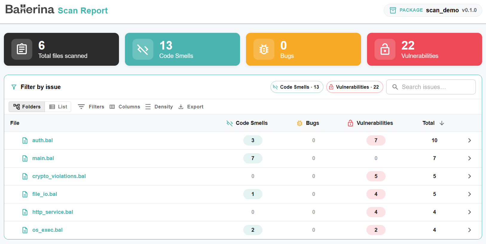
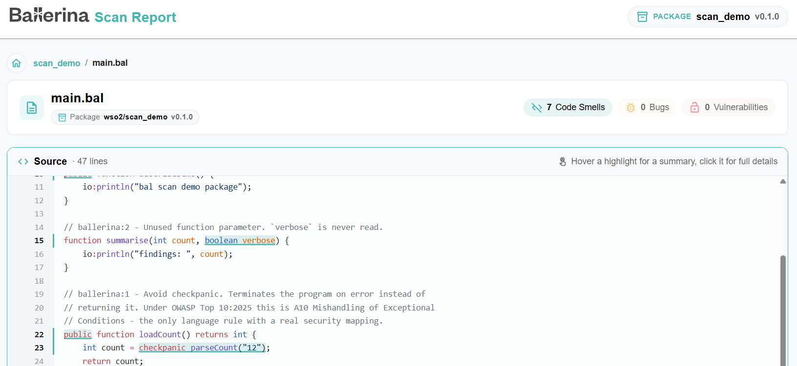

# Scan Tool Overview

Static Code Analysis (SCA) uses tools to examine code without executing the code. They are used for identifying potential issues like bugs, vulnerabilities, and style violations. SCA improves software quality by detecting issues early, ensuring better maintainability, and providing enhanced security. Ballerina supports SCA using the Ballerina scan tool.

The scan tool compile and perform static code analysis, print results to the console, and report results. It analyzes the source code defined in each module when compiling a package or analyzes the given source file when compiling a single Ballerina file. 

Note: Analyzing individual Ballerina files of a package is not allowed.

## Synopsis

```bash
bal scan [OPTIONS] [<package>|<source-file>]
```

## CLI Options

- Specify target path for saving analysis reports. (Only for ballerina build projects)

```text
--target-dir=<path>
```
-  Generate an HTML report containing the analysis results. (Only for ballerina build projects)

```text
--scan-report
```

- Specify the output format (json or sarif). Default is json.

```text
--format=<json|sarif>
```

-  List all available rules

```text
--list-rules
```

-  Run analysis for a specific set of rules. Added to `include` in the `[rule]` table of `Scan.toml`; it cannot be used when `Scan.toml` sets `exclude`, and the scan exits with a usage error.

```text
--include-rules=<rule1, ...>
```

-  Exclude analysis for a specific set of rules. Added to `exclude` in the `[rule]` table of `Scan.toml`; it cannot be used when `Scan.toml` sets `include`, and the scan exits with a usage error.

```text
--exclude-rules=<rule1, ...>
```

- Report the results to these platforms, which must be declared in the `[[platform]]` table of `Scan.toml`. No platform is reported to unless it is named here. The results are printed and saved first; then every named platform is run, and the scan fails if any of them fails. Not supported for a single Ballerina file.

```text
--platforms=<platformName1, ...>
```

- Disregard `@scan:Suppress` annotations and report every issue, to audit the unsuppressed results. Rule inclusion and exclusion still apply. Same as `enabled = false` in the `[suppression]` table of `Scan.toml`. See [Suppressing issues](#suppressing-issues).

```text
--ignore-suppressions
```

- Fail the scan when a `@scan:Suppress` annotation does not give a reason. Same as `requireReason = true` in `Scan.toml`. Has no effect with `--ignore-suppressions` or `enabled = false`.

```text
--require-suppression-reason
```

- Fail the scan when a `@scan:Suppress` annotation does not name the rules it suppresses. Same as `requireRuleId = true` in `Scan.toml`. Has no effect with `--ignore-suppressions` or `enabled = false`.

```text
--require-suppression-rule-id
```

- Leave the test sources of the package, in its `tests` folder and in the `tests` folder of each module, out of the scan, so that their issues and `@scan:Suppress` annotations are not reported. Written alone, it means `true`. Overrides `excludeTests` in the `[analysis]` table of `Scan.toml` either way.

```text
--exclude-tests[=<true|false>]
```

- Fail the scan when the number of issues at or above this severity reaches `--fail-on-count`, or `1` if the count is not set. `NONE` turns the gate off. The value is case-insensitive. Same as `failOnSeverity` in the `[gate]` table of `Scan.toml`. See [Exit codes and the gate](#exit-codes-and-the-gate).

```text
--fail-on-severity=<BLOCKER|HIGH|MEDIUM|LOW|INFO|NONE>
```

- Fail the scan when there are `n` or more issues at or above `--fail-on-severity`, or of any severity if it is not set. A whole number of 1 or more. Same as `failOnCount` in the `[gate]` table of `Scan.toml`. Has no effect when the severity is `NONE`.

```text
--fail-on-count=<n>
```

## Examples

- Run analysis against all Ballerina documents in the current package, print results to the console, and save results in JSON file format in the target directory.

```bash
bal scan
```

- Run analysis against a standalone Ballerina file and print results to the console. The file path of the Ballerina file can be relative or absolute.

```bash
bal scan main.bal
```

- Run analysis and save analysis results in a specified directory.

```bash
bal scan --target-dir="results"
```

- Run analysis and generate an HTML report in the target directory.

```bash
bal scan --scan-report
```

- Run analysis and specify the output format as SARIF.

```bash
bal scan --format=sarif
```

- View all available rules.

```bash
bal scan --list-rules
```

- Run analysis for a specific rule.

```bash
bal scan --include-rules="ballerina:101"
```

- Run analysis for a specific set of rules.

```bash
bal scan --include-rules="ballerina:101, ballerina/io:101"
```

- Exclude analysis for a specific rule.

```bash
bal scan --exclude-rules="ballerina/io:101"
```

- Exclude analysis for a specific set of rules.

```bash
bal scan --exclude-rules="ballerina:101, ballerina/io:101"
```

- Run analysis and report to sonarqube

```bash
bal scan --platforms=sonarqube
```

- Run analysis and report to multiple platforms

```bash
bal scan --platforms="sonarqube, semgrep, codeql"
```

- Run analysis reporting every issue, including those suppressed with `@scan:Suppress`.

```bash
bal scan --ignore-suppressions
```

- Run analysis and fail if any `@scan:Suppress` annotation lacks a reason.

```bash
bal scan --require-suppression-reason
```

- Run analysis and fail on one or more BLOCKER or HIGH issues.

```bash
bal scan --fail-on-severity=HIGH
```

- Run analysis and fail on 5 or more BLOCKER, HIGH or MEDIUM issues.

```bash
bal scan --fail-on-severity=MEDIUM --fail-on-count=5
```

- Run analysis without the test sources of the package.

```bash
bal scan --exclude-tests
```

Each issue in the JSON output has a `location` with one-based lines and columns, as the compiler's diagnostics and the SARIF report do, and the path of the file relative to the package root, such as `modules/db/db.bal`. A single Ballerina file gives its file name. The top-level `filePath` is the path of the file as the scan loaded it.

Only the issues are written to standard output, so `bal scan > issues.json` saves valid JSON, or SARIF with `--format=sarif`. Progress messages, warnings, the issue summary, such as `3 issue(s)`, report paths, and the blank lines between sections are written to standard error.

The console output is printed as sections, in this order, with one blank line between them: configuration, warnings, progress, issues, issue summary, report locations, platform output and the gate result. A section that prints nothing is left out, and warnings raised during the scan, such as unmatched suppressions, are printed before the section that follows them.

## Scan report

To generate a detailed HTML report of the analysis results, use the `--scan-report` option:

```bash
bal scan --scan-report
```

This produces an HTML report and the scan results in JSON format inside the `target/report` directory (or the directory given via `--target-dir`). The report is only generated for Ballerina projects, not for standalone Ballerina files. It is generated even when the results are also reported to a platform.

The HTML report includes a summary of the total number of files scanned and the number of code smells, bugs, and vulnerabilities found in each file. Every scanned file is listed, including files without issues, in a folder tree of the package. You can filter, search, and export the list of files.



To investigate further, click on a file name to open the file view. This view shows the source of the file and highlights the exact lines where problems were detected. Hover over a highlight to see a summary of the issue, or click it to see the full details.



The issues found in the file are listed in a table with the line, rule ID, kind and severity of each issue. The severity is the one the gate counts the rule's kind as: `BUG` as `HIGH`, `VULNERABILITY` as `MEDIUM` and `CODE_SMELL` as `LOW`. Expand an issue to see its description and details such as its location and source, and jump to it in the source using **Show in code**.

## Exit codes and the gate

`bal scan` exits with the standard exit codes of Ballerina CLI tools, so scripts, Git hooks and CI/CD pipelines can act on the result:

| Code | Meaning |
|------|---------|
| `0` | The scan completed, and no gate is set or the gate was not tripped. |
| `1` | The gate was tripped, or the scan could not be completed, for example because of an invalid `Scan.toml`, a package that cannot be loaded, such as one whose `Ballerina.toml` has an error, a compilation error, an empty package, a platform or plugin failure, an invalid suppression or a report that cannot be written. |
| `2` | Invalid command-line input, such as an invalid option value, too many arguments, both `--include-rules` and `--exclude-rules`, a rule option that conflicts with the `[rule]` table of `Scan.toml`, an unknown option, `--platforms` with a single Ballerina file, or an unknown rule ID. |
| `3` | The path is not a Ballerina package or standalone file, or is a `.bal` file inside a package. |
| `130` | The scan was interrupted. |

Every failure other than an interrupt is reported on standard error as `bal scan: error: <message>`, followed by the problems that caused it, such as `Scan.toml:2:18: error: <message>`. Warnings printed by the scan tool are reported as `bal scan: warning: <message>` and never change the exit code.

By default no gate is set, so findings never fail the scan. The gate is set with `--fail-on-severity` and `--fail-on-count`, or with the `[gate]` table of `Scan.toml`, and fails the scan when the number of issues at or above the severity reaches the count:

| --fail-on-severity | --fail-on-count | Fails when |
|----------------------|-------------------|------------|
| Not set | Not set | Never. The gate is off. |
| Not set | `n` | There are `n` or more issues of any severity. |
| `X` | Not set | There is at least one issue at or above `X`. |
| `X` | `n` | There are `n` or more issues at or above `X`. |
| `NONE` | Any | Never. The gate is off. |

```toml
[gate]
failOnSeverity = "MEDIUM"  # same as --fail-on-severity
failOnCount = 5            # same as --fail-on-count
```

Each issue is counted by the kind of its rule: `BUG` as `HIGH`, `VULNERABILITY` as `MEDIUM` and `CODE_SMELL` as `LOW`. Each command-line option replaces only its own setting in the `[gate]` table, with a warning when the values differ, so a setting left off the command line is still read from `Scan.toml`. `--fail-on-severity=NONE` turns off a gate set in `Scan.toml`. `--fail-on-count` does not turn on a gate that `failOnSeverity = "NONE"` turns off; the scan warns that the count has no effect.

The gate counts the issues left after rule selection and suppressions, and is checked after the results are printed, saved and reported to platforms, so a failing scan still leaves a full report. An error always wins over a tripped gate, so the gate is not checked when a platform fails. The gate is off when an analysis platform triggers the scan, since the platform applies its own quality gate.

## Suppressing issues

An individual issue can be accepted in the source with the `@scan:Suppress` annotation from the `ballerina/scan` package. Unlike excluding a rule, which turns it off for the whole project, a suppression applies only to the construct it is attached to and records why the issue is accepted:

```ballerina
import ballerina/crypto;
import ballerina/scan;

function hashPassword(string password) returns string|error {
    @scan:Suppress {rules: ["ballerina/crypto:2"], reason: "Legacy hash kept for the migration window, SEC-1042"}
    string hashed = check crypto:hashBcrypt(password, 4);
    return hashed;
}
```

- **Placement.** The annotation applies to issues reported within the construct it is attached to: a variable or constant declaration, a function, method or resource, a parameter, a return type, a field, a type, a class, a service, a listener, a worker or an `external` function body. A suppression on a service, class, object type or object constructor does not reach issues inside its members. An issue in a statement that is not a declaration can be suppressed by turning the statement into one, for example `var _ = check f();` instead of `check f();`. A suppression the scan cannot apply, such as one on a destructuring declaration or on the return type of a function type, is reported as a warning and ignored.
- **Fields.** Both fields are optional. Without `rules`, every issue in the construct is suppressed; without `reason`, the issue is suppressed without a justification. The annotation can be attached more than once to give each rule its own reason. See the [`ballerina/scan` package documentation](https://central.ballerina.io/ballerina/scan/latest) for examples of each option, the checks done during `bal build` and the editor's code actions.
- **Rule ID validation.** The compiler plugin of `ballerina/scan` reports a malformed rule ID or an empty rule list as a compile error, and `bal scan` reports them as errors too, so that such a suppression never passes as one of no rule. `bal scan` checks that each rule exists, among the core rules and the rules of every analyzer it engages, and fails before reporting anything when one does not. A rule of an analyzer the scan does not engage cannot be verified and is reported as a warning.
- **Results.** Suppressed issues are not printed to the console or sent to platforms, and the issue summary counts them, such as `3 issue(s), 2 suppressed`. They remain in the saved JSON and SARIF reports with a `suppressions` entry of kind `inSource` carrying the reason, so every accepted issue stays reviewable. The HTML report counts them separately from the active issues and lists them, with their reason and the rules the annotation names, under the `Suppressed` or `All` status filter.
- **Unmatched suppressions.** A suppression that matches no issue is reported as a warning, for example when the issue was fixed. A suppression is not reported for a rule left out by `--include-rules`, `--exclude-rules` or `Scan.toml`, and one without `rules` is only reported when every rule is scanned, since whether it is still needed cannot be told from a narrowed scan. An unknown rule still fails the scan, before anything is reported. A rule that an earlier annotation on the same construct already names is reported as already suppressed instead, since that annotation is the one that applies. Likewise, a second annotation without `rules` on a construct is reported as suppressing rules that are already suppressed.
- **Requirements.** A project can require every suppression to give a reason or name its rules, with `requireReason` and `requireRuleId` in the `[suppression]` table of `Scan.toml`, or with the matching command-line options. The requirements have no effect when suppressions are disabled, since every issue is then reported. A suppression that does not meet a requirement fails the scan before anything is reported: the errors are printed, and no issues are printed, saved to the target directory or sent to platforms.
- **Audit.** `--ignore-suppressions` reports every issue as though no suppression existed. To disregard suppressions for every run of a project, for example from a shared `Scan.toml`, set `enabled = false` in the `[suppression]` table.

```toml
[suppression]
enabled = true        # false reports every issue, same as --ignore-suppressions
requireReason = true  # same as --require-suppression-reason
requireRuleId = true  # same as --require-suppression-rule-id
```

## Rules

### ballerina:1 - Avoid checkpanic

When 'checkpanic' is used, the program terminates abruptly with a panic unless it’s handled explicitly along the call stack.

#### Noncompliant Code Example

```ballerina
public function checkResult() {
    json result = checkpanic getResult();

    // ...
}

public function getResult() returns json|error {
    // ...
}
```

#### Compliant Solution

Check and handle the error explicitly.

```ballerina
public function checkResult() {
    json|error result = getResult();

    if result is error {
        // handle error
    }

    // ...
}

public function getResult() returns json|error {
    // ...
}
```

Make use of the 'check' keyword, which immediately returns the error or transfers control to an on-fail block, 
in contrast to 'checkpanic' and panicking if an expression or action evaluates to an error.

```ballerina
public function checkResult() returns error? {
    json result = check getResult();
}

public function getResult() returns json|error {
    // ...
}
```

### ballerina:2 - Unused function parameter

Unused function parameters cause unnecessary code complexity and can lead to confusion for developers
maintaining the code. They may also indicate potential errors in function design or changes in requirements
that were not properly implemented.

#### Noncompliant Code Example

```ballerina
import ballerina/io;

function name(int a, int b) {
   io:println(a);
}

public function main() {
   name(1, 2);
}
```

#### Compliant Solution

Remove unused function parameters to improve code clarity and maintainability. If the parameter is intended for 
future use or completeness, consider documenting it or refactoring the function to use it.

```ballerina
import ballerina/io;

function name(int a) {
   io:println(a);
}

public function main() {
   name(1);
}
```

### ballerina:3 - Non isolated public function
A non-isolated function will not be called concurrently. Only isolated functions are called concurrently given that
they are guaranteed to be safe if the arguments are also safe. To allow being called concurrently,
a public function should be marked as isolated.

#### Noncompliant Code Example

```ballerina
public function helperFunction() {
   // isolated code
}
```

#### Compliant Solution
Mark public functions as isolated to ensure the function can be called concurrently.

```ballerina
public isolated function helperFunction() {
   // isolated code
}
```

### ballerina:4 - Non isolated public method

Class methods can be isolated. An isolated method is the same as an isolated function with self treated as a parameter.
A non-isolated method will not be called concurrently. Only isolated methods are called concurrently given that
they are guaranteed to be safe if the arguments are also safe. To allow being called concurrently,
a public method should be marked as isolated.

#### Noncompliant Code Example

```ballerina
class EvenNumber {
    int i = 1;

    public function generate() returns int {
        return self.i * 2;
    }
}
```

#### Compliant Solution

Mark public methods as isolated to ensure the method can be called concurrently.

```ballerina
class EvenNumber {
    int i = 1;

    public isolated function generate() returns int {
        lock {
            return self.i * 2;
        }
    }
}
```

### ballerina:5 - Non isolated public class

A class defined as isolated is similar to a module with isolated module-level variables.
A non-isolated class will not be accessed concurrently. Only isolated classes are accessed concurrently.
To allow being accessed concurrently, a public class should be marked as isolated.

#### Noncompliant Code Example

```ballerina
public class EvenNumber {
    int i = 1;

    public isolated function generate() returns int {
        lock {
            return self.i * 2;
        }
    }
}
```

#### Compliant Solution

Mark public classes as isolated to ensure the class can be used in a concurrent environment.

```ballerina
public isolated class EvenNumber {
    int i = 1;

    public isolated function generate() returns int {
        lock {
            return self.i * 2;
        }
    }
}
```

### ballerina:6 - Non isolated public object

A non-isolated object will not be accessed concurrently. Only isolated object are accessed concurrently.
To allow being accessed concurrently, a public object should be marked as isolated.

#### Noncompliant Code Example

```ballerina
public type Hashable object {
    function hash() returns int;
};
```

#### Compliant Solution
Mark public objects as isolated to ensure the object can be used in a concurrent environment.

```ballerina
public isolated type Hashable object {
    function hash() returns int;
};
```

### ballerina:7 - This operation always evaluates to true

Conditions that are always true don't do any meaningful computation. They increase code complexity,
reduce the code readability and potentially hide logical errors.

#### Noncompliant Code Example

```ballerina
public function main() {
   int a = 1
   boolean b = a <= int:MAX_VALUE
}
```

### ballerina:8 - This operation always evaluates to false

Conditions that are always false indicate unreachable code or logic that will never execute.
This can clutter the codebase, make it harder to understand, and potentially hide bugs or unintentional logic errors.

#### Noncompliant Code Example

```ballerina
public function main() {
   int a = 1
   boolean b = a <= int:MIN_VALUE;
}
```

### ballerina:9 - This operation always evaluates to the same value

Conditions which always evaluate to the same value don't do any meaningful computation.
They increase code complexity, reduce the code readability, and potentially hide logical errors.

#### Noncompliant Code Example

```ballerina
public function main() {
   int a = x % 1; // always evaluates to zero
}
```

### ballerina:10 - This variable is assigned to itself

Self-assignments, where a variable is assigned to itself (x = x), are redundant and do not alter the state of the variable.
They can indicate incomplete or erroneous logic and make the code harder to read and maintain.

#### Noncompliant Code Example

```ballerina
public function main() {
   int x = 5;
   x = x;
}
```

### ballerina:11 - Unused class private fields

Unused or unread private fields/methods in a class can indicate incomplete or erroneous logic, lead to unnecessary
memory usage, and make the code harder to maintain and understand.

#### Noncompliant Code Example

```ballerina
class A {
  private int[] a = [];
  private int[] b = [];

  function foo() {
    self.a = [2];
  }
}

public function main() {
  A a = new A();
}
```

#### Compliant Solution

Remove the unused private fields/methods. If the field/method is intended for future use or completeness,
consider documenting, refactoring the class to use it, or introducing it when ready to implement the rest.

```ballerina
class A {
  private int[] a = [];

  function foo() {
      self.a = [2];
  }
}

public function main() {
  A a = new A();
}
```

### ballerina:12 - Invalid range expression

The update clause of a range expression should ensure the counter moves in the correct direction.
Incorrect range expression directions can lead to unexpected behavior, making the code harder to understand and debug.

#### Noncompliant Solution

```ballerina
import ballerina/io;

public function main() {
   foreach int i in 9...0 {
       io:println(i);
   }
}
```

#### Compliant Solution

Ensure the range expression counter moves in the correct direction according to the desired iteration.
Use the correct range or adjust the range expression logic to achieve the intended behavior.

```ballerina
import ballerina/io;

public function main() {
   foreach int i in 0...9 {
       io:println(i);
   }
}
```

### ballerina/file:1 - Avoid using publicly writable directories for file operations without proper access controls

Operating systems often have global directories with write access granted to any user.
These directories serve as temporary storage locations like /tmp in Linux-based systems.
However, when an application manipulates files within these directories, it becomes vulnerable to race conditions 
on filenames. A malicious user may attempt to create a file with a predictable name before the application does.
If successful, such an attack could lead to unauthorized access, modification, corruption, or deletion of other files.
This risk escalates further if the application operates with elevated permissions.

#### Noncompliant Code Example

```ballerina
string tempFolderPath = os:getEnv("TMP");
check file:create(tempFolderPath + "/" + "myfile.txt");
check file:getAbsolutePath(tempFolderPath + "/" + "myfile.txt");
check file:createTemp("suffix", "prefix");
check file:createTempDir((), "prefix");
```

#### Compliant Solution

Use dedicated sub-folders.

```ballerina
check file:create("./myDirectory/myfile.txt");
check file:getAbsolutePath("./myDirectory/myfile.txt");
```

### ballerina/file:2 - File function calls should not be vulnerable to path injection attacks

Path injections occur when an application constructs a file path using untrusted data without first validating the path.

A malicious user can inject specially crafted values, like "../", to alter the intended path. This manipulation may 
lead the path to resolve to a location within the filesystem where the user typically wouldn't have access.

#### Noncompliant Code Example

```ballerina
listener http:Listener endpoint = new (8080);
string targetDirectory = "./path/to/target/directory/";

service / on endpoint {
    resource function get deleteFile(string fileName) returns string|error {
        check file:remove(targetDirectory + fileName);
        // ...
    }
}
```

#### Compliant Solution

Conduct validation of canonical paths.

```ballerina
listener http:Listener endpoint = new (8080);
string targetDirectory = "./path/to/target/directory/";

service / on endpoint {
    resource function get deleteFile(string fileName) returns string|error {
        // Retrieve the normalized absolute path of the user provided file
        string absoluteUserFilePath = check file:getAbsolutePath(
            targetDirectory +
            fileName);
        string normalizedAbsoluteUserFilePath = check file:normalizePath(
            absoluteUserFilePath,
            file:CLEAN);

        // Check whether the user provided file exists
        boolean fileExists = check file:test(
            normalizedAbsoluteUserFilePath,
            file:EXISTS);
        if !fileExists {
            return "File does not exist!";
        }

        // Retrieve the normalized absolute path of parent directory of the user provided file
        string canonicalDestinationPath = check file:parentPath(
            normalizedAbsoluteUserFilePath);
        string normalizedCanonicalDestinationPath = check file:normalizePath(
            canonicalDestinationPath,
            file:CLEAN);

        // Retrieve the normalized absolute path of the target directory
        string absoluteTargetFilePath = check file:getAbsolutePath(
            targetDirectory);
        string normalizedTargetDirectoryPath = check file:normalizePath(
            absoluteTargetFilePath,
            file:CLEAN);

        // Perform comparison of user provided file path and target directory path
        boolean dirMatch = normalizedTargetDirectoryPath.equalsIgnoreCaseAscii(
            normalizedCanonicalDestinationPath);
        if !dirMatch {
            return "Entry is not in the target directory!";
        }

        check file:remove(normalizedAbsoluteUserFilePath);
    }
}
```

### ballerina/http:1 - Avoid allowing default resource accessor

An HTTP resource is safe when used for read-only operations like GET, HEAD, or OPTIONS. An unsafe HTTP resource is used
to alter the state of an application, such as modifying the user’s profile on a web application.

Unsafe HTTP resources include POST, PUT, and DELETE.

Enabling both safe and insecure HTTP resources to execute a particular operation on a web application may
compromise its security; for instance, CSRF protections are typically designed to safeguard operations executed by
insecure HTTP resources.

#### Noncompliant Code Example

```ballerina
listener http:Listener endpoint = new (8080);

service / on endpoint {
    // Sensitive: by default all HTTP methods are allowed
    resource function default deleteRequest(http:Request clientRequest, string username) returns string {
        // state of the application will be changed here
    }
}
```

#### Compliant Solution

For every resource in an application, it’s crucial to explicitly define the type of the HTTP resource,
ensuring that safe resources are exclusively used for read-only operations.

```ballerina
service / on endpoint {
    resource function delete deleteRequest(http:Request clientRequest, string username) returns string {
        // state of the application will be changed here
    }
}
```

### ballerina/http:2 - Avoid permissive Cross-Origin Resource Sharing

Having a permissive Cross-Origin Resource Sharing policy is security-sensitive, and it has led in the past to the 
following vulnerabilities.

- [CVE-2018-0269](http://cve.mitre.org/cgi-bin/cvename.cgi?name=CVE-2018-0269)
- [CVE-2017-14460](http://cve.mitre.org/cgi-bin/cvename.cgi?name=CVE-2017-14460)

Browsers enforce the same-origin policy by default, as a security measure, preventing JavaScript frontends from
making cross-origin HTTP requests to resources with different origins (domains, protocols, or ports).
However, the target resource can include additional HTTP headers in its response, known as CORS headers, which serve 
as directives for the browser and modify the access control policy, effectively relaxing the same-origin policy.

#### Noncompliant Code Example

```ballerina
listener http:Listener endpoint = new (8080);

service / on endpoint {
    @http:ResourceConfig {
        cors: {
            allowOrigins: ["*"] // Sensitive
        }
    }

    resource function get example() returns http:Response|error? {
        // Return response
    }
}
```

#### Compliant Solution

The resource configuration should be configured exclusively for trusted origins  and specific resources.

```ballerina
listener http:Listener endpoint = new (8080);

service / on endpoint {
    @http:ResourceConfig {
        cors: {
            allowOrigins: ["trustedwebsite.com"] // Compliant
        }
    }

    resource function get example() returns http:Response|error? {
        // Return response
    }
}
```

### ballerina/io:1 - I/O function calls should not be vulnerable to path injection attacks

Path injections occur when an application constructs a file path using untrusted data without first validating the path.

A malicious user can inject specially crafted values, like "../", to alter the intended path. This manipulation may 
lead the path to resolve to a location within the filesystem where the user typically wouldn't have access.

#### Noncompliant Code Example

```ballerina
import ballerina/io;
import ballerina/http;

service /fileService on new http:Listener(8080) {
   resource function get file(string fileName) returns string|error {
       // Noncompliant: User input is directly concatenated into the file path
       string filePath = "./resources/" + fileName;

       // Reading file without validating the path
       string content = check io:fileReadString(filePath);
       return content;
   }
}
```

#### Compliant Solution

Validate and normalize the path to ensure the accessed file remains within the intended target directory.

```ballerina
import ballerina/io;
import ballerina/http;
import ballerina/file;

service /fileService on new http:Listener(8080) {
    resource function get file(string fileName) returns string|error {
        string targetDirectory = "./resources/";

        // Retrieve the normalized absolute path of the user-provided file
        string absoluteUserFilePath = check file:getAbsolutePath(targetDirectory + fileName);
        string normalizedAbsoluteUserFilePath = check file:normalizePath(absoluteUserFilePath, file:CLEAN);

        // Retrieve the normalized absolute path of the target directory
        string absoluteTargetFilePath = check file:getAbsolutePath(targetDirectory);
        string normalizedTargetDirectoryPath = check file:normalizePath(absoluteTargetFilePath, file:CLEAN);

        // Perform comparison of user provided file path and target directory path
        boolean dirMatch = normalizedTargetDirectoryPath.equalsIgnoreCaseAscii(
        check file:parentPath(normalizedAbsoluteUserFilePath));
        if !dirMatch {
            return "Access to files outside the target directory is not allowed!";
        }

        string content = check io:fileReadString(normalizedAbsoluteUserFilePath);
        return content;
    }
}
```

### ballerina/log:1 - Potentially-sensitive configurable variables are logged

In Ballerina, configurable variables typically contain sensitive data that should not be exposed externally and are 
usually kept secret. This includes credentials to access external systems, such as databases.
To protect users' privacy, information is forbidden or strongly discouraged from being logged,
such as user passwords or credit card numbers, which should obviously not be stored or at least not in clear text.

#### Noncompliant Code Example

```ballerina
import ballerina/log;

configurable string password = ?;
configurable string user = ?;

public function main() {
   log:printInfo(password);
   log:printError(string `Error: ${password}`);
   log:printWarn(`Error: ${password}`);
   log:printError("Error " + password);
   log:printWarn("Warning", password = password);
   log:printError("Error", password = password, user = user);
}
```

#### Compliant Solution

Avoid using configurable variables inside the logging statement.

```ballerina
import ballerina/log;

int id = 12345;

public function main() {
   log:printInfo(“task executed successfully.”, id = id);
}
```

### ballerina/os:1 - Avoid constructing system command arguments from user input without proper sanitization

Arguments of system commands are processed by the executed program.
The arguments are usually used to configure and influence the behavior of the programs.
Control over a single argument might be enough for an attacker to trigger dangerous features like
executing arbitrary commands or writing files into specific directories.

Arguments like -delete or -exec for the find command can alter the expected behavior and result in vulnerabilities.

#### Noncompliant Code Example

```ballerina
string terminalPath = ...;
string input = request.getQueryParamValue("input").toString();
string[] cmd = [..., input];

// Sensitive
os:Process result = check os:exec({
    value: terminalPath,
    arguments: cmd
});
```

#### Compliant Solution

Use an allow-list to restrict the arguments to trusted values.

```ballerina
string terminalPath = ...;
string input = request.getQueryParamValue("input").toString();
string[] cmd = [..., input];
string[] allowed = ["main", "main.bal", "bal"];

if allowed.some(keyword => keyword.equalsIgnoreCaseAscii(input)) {
    os:Process result = check os:exec({
        value: terminalPath,
        arguments: cmd
    });
}
```
